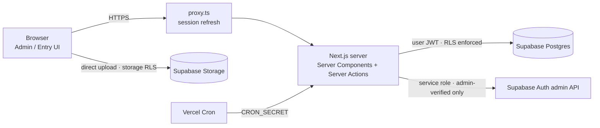
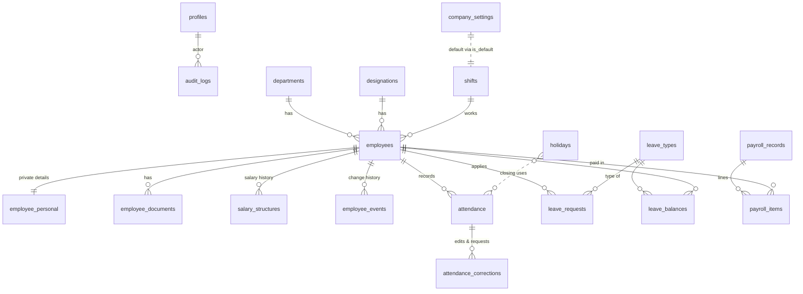

# Architecture — ALL SHEBA HRMS

## Overview



Access is checked at four layers:

1. **Proxy:** signed-out visitors are redirected away from `/admin`, `/entry` and the account pages.
2. **Layouts and pages:** `requirePageRole()` sends each role to its own panel.
3. **Server actions:** every mutation calls `assertRole()` and validates input with Zod.
4. **Database:** RLS policies and `SECURITY DEFINER` RPCs check the role again, and triggers enforce business rules (late calculation, duplicate prevention, payroll immutability, audit).

## Database ERD



| Table | Purpose |
|-------|---------|
| `profiles` | App user, role (`admin` / `entry`), active flag, forced password change |
| `departments`, `designations`, `shifts`, `holidays` | Organisation and work calendar |
| `company_settings` | Single row holding every configurable business rule |
| `employees` | Operational directory (visible to Entry) |
| `employee_personal` | Sensitive personal data (admin only) |
| `employee_documents` | Metadata for private storage files |
| `salary_structures` | Append-only salary history |
| `employee_events` | Designation, department, status and salary change log |
| `attendance` | One row per employee per day; scheduled and actual times stored separately |
| `attendance_corrections` | Automatic edit history plus Entry correction requests |
| `leave_types`, `leave_balances`, `leave_requests` | Leave policies, allocations, applications |
| `payroll_records`, `payroll_items` | Monthly payroll with frozen snapshots |
| `audit_logs` | Append-only audit trail |

## Permission matrix

| Capability | Admin | Entry |
|------------|:-----:|:-----:|
| Dashboard (full analytics) | ✓ | — (own operational dashboard) |
| Employee directory | ✓ | read |
| Employee personal data, documents, salary | ✓ | — |
| Create, edit or archive employees | ✓ | — |
| Record attendance | ✓ any past date | today (+ configured back-date days) |
| Edit attendance | ✓ with reason, locks record | own unlocked entries within the edit window |
| Delete attendance | ✓ | — |
| Close attendance (mark absent etc.) | ✓ | — |
| Correction requests | review | submit |
| Leave applications | create, approve, reject, cancel | submit, cancel own pending |
| Leave policies and balances | ✓ | read balances |
| Payroll and payslips | ✓ | — |
| Reports and exports | all | daily and attendance reports |
| Users, settings, departments, holidays, shifts | ✓ | — |
| Audit logs | read | — |

## Folder structure

```
supabase/migrations/      SQL migrations (schema, logic, RLS, storage, defaults)
scripts/provision.ts      One-time creation of the admin/user accounts
src/proxy.ts              Session refresh + route protection
src/app/(auth)/           Login, change password, auth actions
src/app/admin/            Admin panel (13 modules)
src/app/entry/            Entry panel (quick attendance, today, history, corrections, leave)
src/app/api/cron/         Automatic attendance closing
src/components/           UI: shared, attendance, leave, reports, charts, layout, shadcn/ui
src/lib/                  Auth, data loaders, actions, calculations, report engine
src/lib/reports/          Catalog, builders (server), exporters (PDF/XLSX/CSV, client)
tests/db/                 PGlite database tests (migrations, triggers, RLS, payroll)
tests/unit/               Pure function tests
docs/                     Setup, deployment, payroll, architecture
```

## Report engine

`buildReport()` (server) turns validated URL parameters into a `ReportDocument` built from live data. `ReportViewer` (client) renders that one document as a print preview, browser print (A4 portrait or landscape, repeated table headers, page numbers), PDF (jsPDF with header and footer on every page and "Page X of Y"), Excel (ExcelJS with logo, numeric cells and number formats) and CSV (UTF-8 BOM, protected against formula injection). Every export is written to the audit log; sensitive reports are flagged.
